# Aniseed (Version 4.*)

Aniseed is an application embedded (Maya) rigging tool. 

## What's New: aniseed_utilities replaces aniseed_toolkit

The `aniseed_toolkit` library has been removed. Its code now lives in aniseed packages,
and the packages have dropped `maya` from their names (everything in `aniseed_maya` is
Maya specific). Rigs are unaffected, as components keep their identifiers, but any of
your own code which imports the toolkit needs updating.

* `aniseed_toolkit.{core,scene,rig,ui,utils,resources}` is now
  `aniseed_utilities.{core,scene,rig,ui,utils,resources}`, imported as
  `import aniseed_utilities as au` (so `aniseed_toolkit.rig.control.create` is
  `au.rig.control.create`).
* `aniseed_toolkit.rigging` is now `aniseed_standard.rigging`
  (`from aniseed_standard import rigging`).
* `aniseed_maya_standard.mixins.MirrorMixin` is now `au.mixins.MirrorMixin`.
* The control shape library moved from `aniseed_toolkit/_resources/shapes` to
  `aniseed_utilities/_res/shapes`.
* `aniseed_utilities` also holds the Maya host and the general purpose components
  (utilities, the global control root, space switching, control insertion and the
  singulars), so it is always on.
* Package renames:
    * `aniseed_maya_standard` is now `aniseed_standard`
    * `aniseed_maya_cartoon` is now `aniseed_cartoon`
    * `aniseed_maya_rigging_toolkit` is now `aniseed_rigging_toolkit`
    * `aniseed_maya_animation_toolkit` is now `aniseed_animation_toolkit`
    * `aniseed_maya_dev_examples` is now `aniseed_dev_examples`

  Saved on/off choices for the renamed packages are reset to their defaults.

## What's New: the Rigging and Animation Toolkits (aniseed_toolkit 5)

The single Aniseed Toolkit window is replaced by two xstack based windows, the
**Rigging Toolkit** and the **Animation Toolkit** (see
[The Rigging and Animation Toolkits](#the-rigging-and-animation-toolkits)). Rigs are
unaffected, but any of your own code which ran or wrote toolkit tools needs updating.

* `aniseed_toolkit` is now purely a library. `aniseed_toolkit.run`, `aniseed_toolkit.Tool`,
  `@aniseed_toolkit.tool`, `aniseed_toolkit.register`, `aniseed_toolkit.launch` and the
  `ANISEED_TOOLKIT_PATHS` environment variable have been removed. Call the library
  function a tool used instead, for example:
    * `"Create Control"` is `aniseed_toolkit.rig.control.create`
    * `"Create Guide"` is `aniseed_toolkit.rig.guide.create`
    * `"Create Joint"` is `aniseed_toolkit.scene.joints.create`
    * `"Tag Node"` is `aniseed_toolkit.rig.tagging.tag`
    * `"Get Controls"` is `aniseed_toolkit.rig.all_controls`
    * `"Zero Control"` is `aniseed_toolkit.rig.zero`
    * `"Get Shape List"` is `aniseed_toolkit.scene.shapes.library` (which returns names)
    * `"Get MObject"` / `"MObject Name"` are `aniseed_toolkit.core.api.get_mobject` / `get_name`
* Tools are now `aniseed.toolkits.Tool` subclasses (xstack components with options) in
  the `tools` folder of an aniseed package. Run one from code with
  `aniseed.toolkits.run("<tool name>", options={...})`.

## What's New in Version 4

Version 4 restructures the Aniseed Toolkit (the library of rigging functions which
components and tools are built on). Rigs built with Aniseed are unaffected, but any of
your own code which imports from the toolkit will need updating.

* The toolkit is now organised into layers, each of which only uses the layers before it:
    * `aniseed_toolkit.core` : units, naming, maths, attributes, selection and directions
    * `aniseed_toolkit.scene` : transforms, joints, constraints, shapes, skin, surfaces and node maths
    * `aniseed_toolkit.rig` : controls, guides, tagging, pinning, spaces and the pose mixer
    * `aniseed_toolkit.rigging` : ik/fk, soft ik, foot roll, blend chains, twist, spline and ribbon setups
* The old module locations (such as `aniseed_toolkit.joints` or `aniseed_toolkit.lib.*`)
  have been removed. For example, `aniseed_toolkit.joints` is now `aniseed_toolkit.scene.joints`
  and `aniseed_toolkit.control` is now `aniseed_toolkit.rig.control`.
* Tools were still run by name in version 4 (this was removed in aniseed_toolkit 5, see above).
* Duplicating a component through the UI now lets you rename it and apply a search and
  replace to its values as part of the duplication.

You can view a quick introduction video here:
https://youtu.be/rNy7F64nDiw

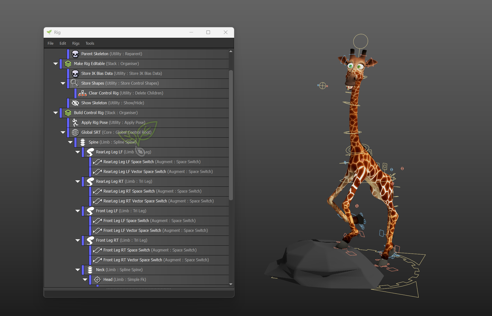


## What is Aniseed

Aniseed is a modular rigging tool which prioritises flexibility. There is no preconception
as to what a module (component) should do, one module might be an incredibly complex
tentacle whilst another component might simply apply colours to controls based on names.
Essentially each module can declare inputs and options, and once build it can also
share its outputs.

You can see aniseed being used to create a rig from scratch here:
https://youtu.be/bTsgaC-UOrg

## How is this different?

There are many modular rigging tools available. Some of them are more bespoke to 
characters - making assumptions about what makes up a rig. Others are flexible in that
they do not make assumptions about the compnents but they do make assumptions about
what structure a component takes. 

In many of these cases we end up with lots of half managed post-scripts executing 
after a rig build in order to tail inter-module connections or to fit the rigging 
process within a pipeline. 

I wanted a rigging framework which does not assume that a component will construct 
objects, or that we explicitely want guides. I did not want a framework where I would 
have to manage lots of bespoke post scripts to manage RBF data or the applying of 
skinning etc. 

Aniseed avoids this situation because we can simply write a component/module to store
or apply skin data. If we have to manage RBF data we can do that with a module too. In 
this approach everything becomes consistent and re-usable. There is no concept of a post
script because everything is just a module in the execution stack.

## What modules are there?

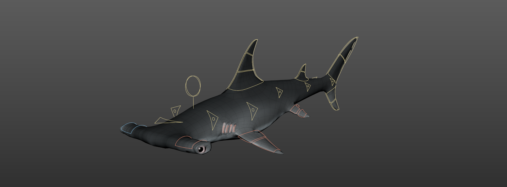

Out the box Aniseed comes with a variety of modules suited for bipeds and quadrupeds as 
well as some more generalised modules for FK setups. On top of that there are a series
of utility style modules (showing/hiding elements or applying and colouring controls etc).

## Does Aniseed use Guides?

Many of the more complex components (spines, legs, arm etc) use guides to help place
the joints that are created. However not all modules create guides, and having guides
is not a mandatory feature of an aniseed component. Therefore if you dislike guides 
and are willing to author your own components then you can have an enitrely joint driven
workflow too. 

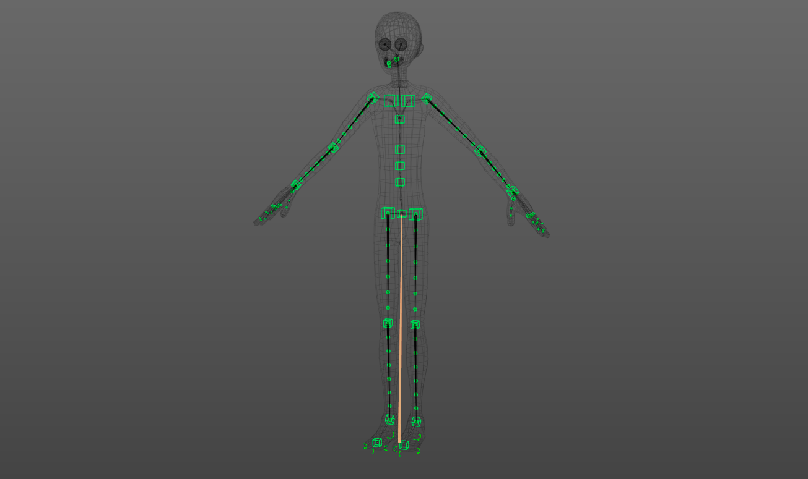

Flexibility is the key here. The components that aniseed ships with typically utilise
guides where it makes sense, but that is the choice of each component/module and not 
something forced by the framework. 


## Aniseed Out the Box

The framework of Aniseed is very unassuming. Therefore if you're willing to write your
own modules you can absolutely choose to take a guide first approach or a joint first
approach and anything in between! However, all the components which come with Aniseed
out the box take a joint first approach - though some do allow you to generate guides
to help manipulate them.


# Aniseed's Expectations

It is important to note that Aniseed focuses on flexibility and adaptability - allowing
it to be used in a variety of pipeline environments. Therefore it typically prioritises
user flexibility over a plug and play nature. Therefore a good understanding of rigging,
hierarchies, scene structure are a must. 

# Installing

### Using the Drag & Drop Installer
To install aniseed within Maya download the release and unzip it into your downloads folder. 

Navigate into the unzipped folder and you will see a drag_drop_install.py file. Simply drag 
and drop that into the Maya viewport. This will start the installation process.

By default, the aniseed module will be installed in your maya's user location within the
module's folder. 

A video walkthrough of installing Aniseed can be found here:

https://youtu.be/hMnltJR2OWE


### Manually Installing
Aniseed is packaged as a *Maya Module*, therefore to manually install it you should
upzip the release, then place the .mod and the aniseed_maya folder within one of the 
MAYA_MODULE_PATH locations. 

# Launching

Aniseed will show in the main menu when you switch to the rigging workspace. To launch
the main tool, choose "Anseed Builder".

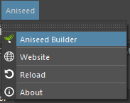

All of aniseed is also fully exposed through Python. You can launch the Aniseed Builder
using the following python code

```python
import aniseed
aniseed.app.launch()
```

Note: All functionality available through the UI is also available in a headless/code-only
form as well.

# Getting Started with Aniseed

When you first launch Aniseed, it will look like the image shown below. This is what
you will see when there is no rig present within the scene. 


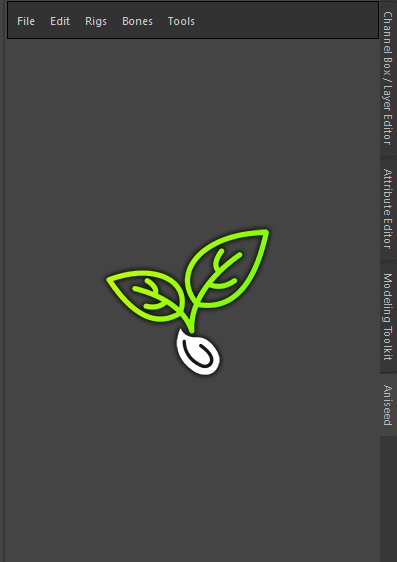

The menu at the top allows you to create new rigs, switch between rigs in the scene
as well as exposing various bone mand shape manipulation tools. 

You can view a walkthrough of building your first rig in aniseed here:
https://youtu.be/bTsgaC-UOrg

```
It is highly recommended that you play with some of the examples to get a feel for
how the tool works and what a typical rig stack looks like. There are currently two 
example rig files you can look at:

* BipedRig.ma : This is a standard bipedal rig built using aniseed
* GiraffeRig.ma (Quadruped with tri legs and spline neck/spine)

Both can be opened in Maya 2025 and beyond and can be Unbuilt/rebuilt. Also included
in the examples directory is a json file for each, which can be used to build a 
completely fresh rig from.
```
## Creating a new Rig

Click File/New Rig

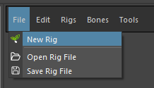

This will ask you  for a name for your rig. This is simply the name it will assign to
the rig node adn you can change this at any time. 

Your tool should now appear like this:

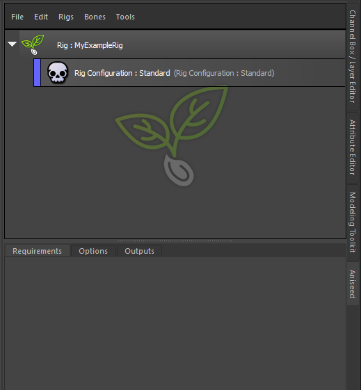

"Rig : MyExampleRig" is our actual rig. All components we create will be a child of 
this in some form. The "Rig Configuration" is a special component - all rigs MUST have
a "Rig Configuration" component. By default Aniseed will create this for  you, however
if you're working in a studio pipeline where you dont want a rig configuration or you 
want to specify your own to be created automatically you can do this through the 
preferences (Edit/Preferences).

If you select the "Rig Configuration" component you will see that you are presented
with all its options. This allows you to tailor the conventions the tool will use when
building the rig. 

Components may expose any (or all) of the following:

### Requirements
These are fields that you are expected to fill in. They are typically mandatory for the
component to build and usually represent objects which that component needs.

### Options
These are fields that allow you to tailor the result of the component. This may allow 
you to change the behaviour of the component or the naming of the component etc. These
are usually predefined with default values.

### Outputs
These are fields which the selected component promises to populate as part of its 
execution. Typically with requirements (or any field that expects an object), you can 
chooes to either enter the objects name, or you can provide an "address" to an output
field. By using the address you're not hard coding the naming convention into your
setup. This is covered in more detail below.

## Adding Components & Building
This is the absolute minimum for a rig - if you right click the "Rig : MyExampleRig"
you will be presented with a context menu. From this menu you can select "Build", and 
that will execute (build) all the components declared in the rig. In this case, nothing 
will change in the scene, as the only component (the configuration component) does not 
actually do anything in of itself. However, you should see it go green to say that it 
was successfully executed.

Right click the Rig node again, and this time choose "Add Component". This will present
you with a dialog showing all the available components. 

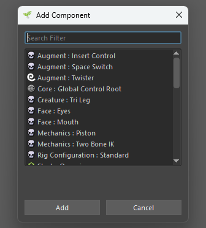

As well as showing you all the available components, you can click a component and 
see any help text that component offers. Some components will also expose some of their
options to you through this dialog as well. Its worth noting that any options you set
in this dialog can be changed later too.

## Example Workflow

To demonstrate this, select the "Mechanics : Two Bone IK" component and set the location
option to "md", then click "Add". This will add that component to the aniseed stack. Now
you can click that component and see that it requires a Parent as well as a Root joint
and a Tip joint (as shown below).

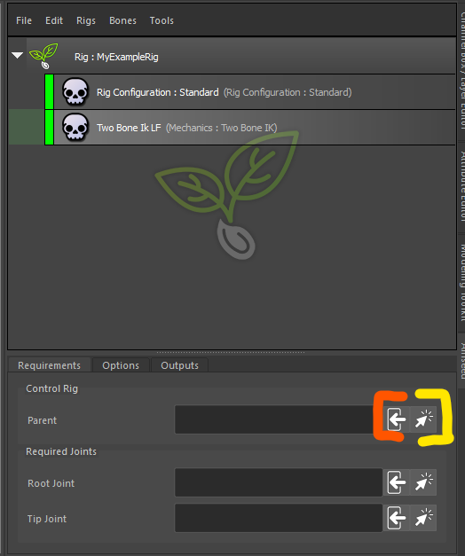

All three of the requirements for this component require "objects" (i.e, nodes in the 
scene). This field has two buttons next to it, the button highlighted in orange will 
fill the field with the selected object whilst the butten highlighted in yellow will 
select the object in the scene. Start by selecting the rig node in the outliner and then
clicking the "Set From Scene" button. This will place the nodes name into that field. 

Now draw three joints in a hierarchy within your scene. Select the first joint and fill
in the "Root Joint" field, then select the last joint and fill in the "Tip Joint" field.

Lets go ahead a test our rig - right click the "Rig : MyExample" section at the top of
the Aniseed tool and choose "Build/Build Rig". You should see the components go green 
and a set of IK controls built around your skeleton. 

This is the most simplistic way of using Aniseed, where you're working with the stack 
as a Linear Execution Stack (i.e, building all components from top to bottom).

## Iterative Building Workflow

In reality, when we build rigs we rarely get things exactly as we want them first time. 
Quite often we will want to rebuild our rig, then change some settings or extend it 
further and rebuild it again. This process is usually repeated a lot during the lifespan
of a rig in production - and it is why dedicated rigging tools such as Aniseed exist. 

Therefore, simply executing all components from top to bottom is not incredibly 
efficient. If we take the example above, if we hit build again, we would end up with 
another set of IK controls for each time we built our rig. Therefore it would require 
the rigger to clean the scene up each time. 

This is why Aniseed allows you to execute "sub sections" of a stack rather than the 
whole stack. This way you can group your stack its different sets of functionality
which can be invoked for different purposes. 

You can see this in practice if you right click the "Rig Configuration" item and choose
"Create Initial Component Structure". This initial rig structure is intended as a 
"good practice starting point". As you can see in the image below, it defines an inital 
rig structure - this just creates a series of group nodes to help keep our skeleton, 
geometry and controls seperate from one another. 

We then have a "Make Rig Editable" section. This has nodes which specifically look over
the control rig, store shape information and then delete the control rig. 

The "Build Control Rig" does what it says on the tin. This section creates a global 
control root, re-applies control shapes and applies control colours. 

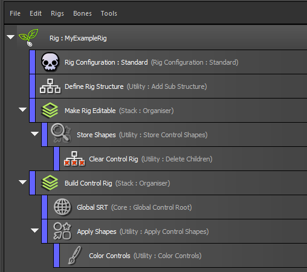


# Aniseed Toolkit

The Aniseed Toolkit is both a user facing tool and a code factory which can be called
and used by components or other tools. 

You can launch the user facing tool through either the Aniseed menu or through the 
Tools menu within aniseed. This will present you with a list of available tools which 
you can double click to instigate. To see documentation relating to the tool simply
hover your cursor over the tool - the tooltip will show the documentation.

There are (currently) two classifications of tools which you can switch between. These
are:

* Animation
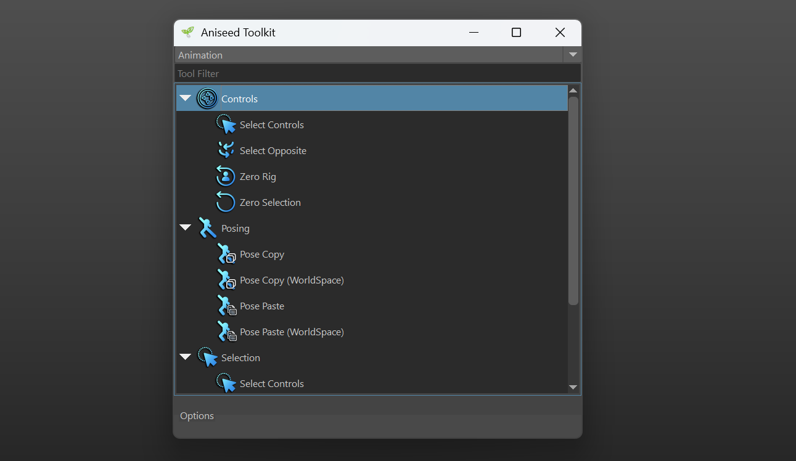

* Rigging
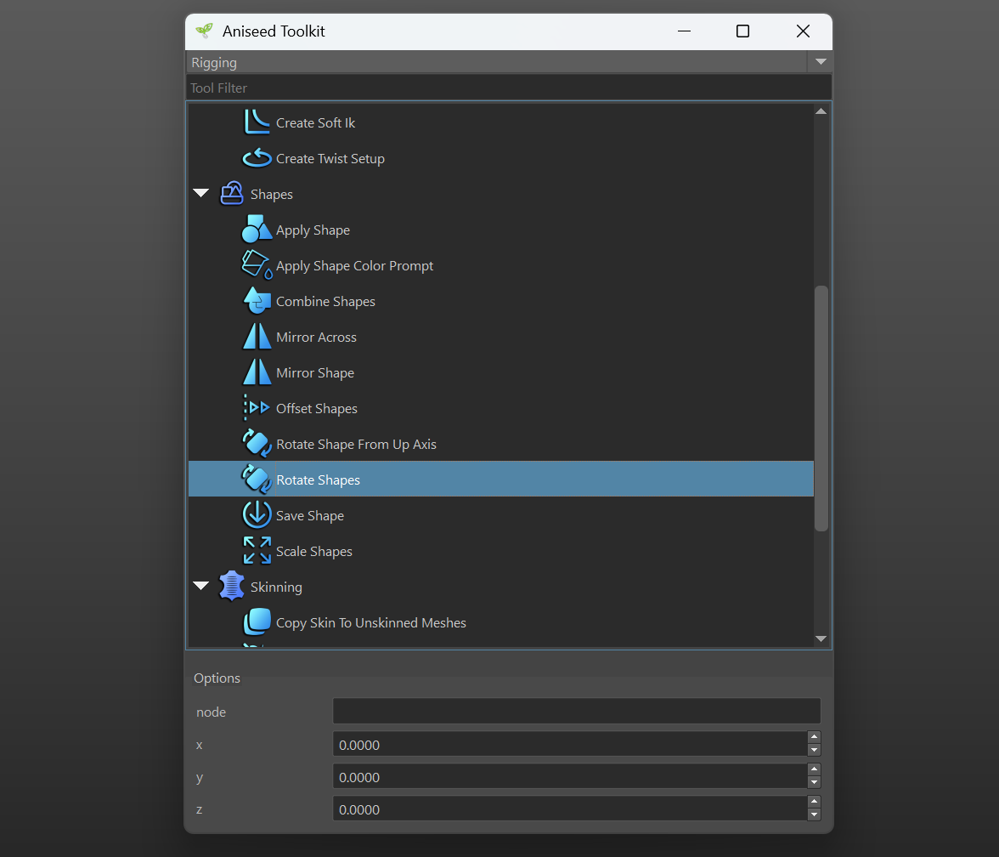

# Using Aniseed 

This area of the documentation is still to be completed. But there are some video walkthrough guides:

ADD VIDEO LINK

# Coding With Aniseed

The core of aniseed is application agnostic. All application specific code - components,
mixins, widgets and hosts - lives in aniseed packages, which sit alongside the aniseed
module. `aniseed_utilities` holds the utility library, the general purpose components and
the Maya host, and the standard Maya limbs and mechanisms are in `aniseed_standard`.

If you want to add your own rigging components you can either:

* Create an aniseed package. This is a folder containing an `aniseed_package.json` file,
where the folder name is the package name. Aniseed looks within it for `components`,
`mixins`, `widgets` and `hosts` folders, and the aniseed toolkit looks within its
`tools` folder for tools to expose to the user. Place the package alongside the aniseed module,
or declare its path (or the path of a folder of packages) in an environment variable
called ANISEED_PACKAGE_PATHS. This is the best option for sets of components which belong
together, such as a muscle setup, and keeps studio code separate from open source code.
See `aniseed_utilities/README.md` for details.


* Place your components in a folder and declare that folder path in an environment
variable called ANISEED_RIG_COMPONENT_PATHS. This is useful for a few loose components.

Component and tool identifiers must be unique across aniseed and all aniseed packages.

## Aniseed Classes

The Rig class is the one you will typically use as the entrypoint to working with Aniseed
at a code level. The rig class gives a pointer to the node representing the rig as well as 
containing all the information about the components that form to make up the rigs execution. 

Crucially it also gives access to the rigs configuration - which is covered below.

You can create a new rig using the following code. This will create a rig called MyNewRig
in the scene. It will expose all the components that are available to aniseed out the box.

```python
import aniseed

new_rig = aniseed.Rig(label="MyNewRig")
```

Alternatively, if there is already a rig in the scene, assuming the rig transform is called
MyNewRig, you can do...

```python
import aniseed

new_rig = aniseed.MayaRig(host="MyNewRig")
```

Now that you have a rig class instanced, you can start adding components to your rig. In this
example we add some basic components to demonstrate. 

```python
new_component = new_rig.add_component(
    component_type="simple_fk",
)
```


As well as just adding the component, we can define options and requirement values at the same
time as adding the component, like so:

```python
new_component = new_rig.add_component(
    component_type="simple_fk",
    requirements={
        "Parent": "Foobar",
        "Joints To Drive": ["A", "B", "C"],
    },
    options={
        "Label": "Head",
    }
)
```

The approach above allows you to specify values at the time of the components creation. However, 
you can also set these values directly on the component after creation too. This is done like this:

```python
new_component = new_rig.add_component(
    component_type="simple_fk",
)
new_component.requirement("Parent").set("Foobar")
new_component.requirement("Joints To Drive").set(["A", "B", "C"])
new_component.option("Label").set("Head")
```

The result between these two examples is exactly the same.

Now that we have components in our rig, we can build it. To do this is simply:

```python
new_rig.build()
```

That will run through all the components in the rig and execute them.

Note that a rig must **ALWAYS** have a Rig Configuration component added to it in 
order to build. A RigConfiguration is nothing more than a component that exposes a
specific set of parameters and functions that allow a user to tailor how a rig is
built. 

Aniseed comes packaged with a rig configuration which is designed to be flexible, 
however if you find that you need something more, you can always subclass the RigConfiguration
component and implement your own. This is explained below.

Everything you do through the UI can be scripted. Here is an example of building a
rig with spine and legs

```python
import aniseed

# -- Start by create a new rig
rig = aniseed.Rig(label="ExampleRig")

# -- Add a rig configuration to the rig
rig.add_component(
    component_type="Rig Configuration : Standard",
    label="Configuration",
)

# -- The rig configuration has a custom function to 
# -- allow for a basic rig structure to be made
rig.config().create_component_structure()

# -- Now add a spine component as a child of the global srt component. Note
# -- that the global srt component is generated for us from the rig
# -- configuration
spine_component = rig.add_component(
    component_type="Limb : Spline Spine",
    label="Spine",
    parent=rig.find("Global SRT"),
)

# -- Rather than build the skeleton manually, we will let the component
# -- do this for us
spine_component.user_func_build_skeleton(joint_count=6)

# -- In this example, we're setting the parent attribute
# -- to the address of the main control of the srt. We use the address
# -- rather than a hard coded name to allow for naming flexibility
spine_component.input("Parent").set(
    rig.find("Global SRT").output("Main Control").address()
)

# -- Now we add the left leg component. Note that in this example we're
# -- specifying the parent requirement at the time of adding it rather
# -- that setting the attribute after the fact
left_leg_component = rig.add_component(
    component_type="Limb : Leg",
    label="Leg LF",
    parent=spine_component,
    options={"Location": "lf"},
    inputs={
        "Parent": spine_component.output("Root Transform").address()
    }
)

# -- Now we create the skeleton. By default this will also generate 
# -- a guide for us. Both the option of creating a skeleton and a guide
# -- is specific to any given component. 
left_leg_component.user_func_create_skeleton(
    parent=spine_component.input("Root Joint").get(),
    upper_twist_count=3,
    lower_twist_count=3,
)

# -- Now we do exactly the same for the right leg. Note that the leg component
# -- will mirror itself if its build with the right side set. This is a logic
# -- choice in the component itself rather than a framework choice. 
right_leg_component = rig.add_component(
    component_type="Limb : Leg",
    label="Leg RT",
    parent=spine_component,
    options={"Location": "rt"},
    inputs={
        "Parent": spine_component.output("Root Transform").address()
    }
)

right_leg_component.user_func_create_skeleton(
    parent=spine_component.input("Root Joint").get(),
    upper_twist_count=3,
    lower_twist_count=3,
)

# -- Finally, because all the components we have added in this example use
# -- guides, we need to remove them before we build the rig. 
spine_component.user_func_remove_guide()
left_leg_component.user_func_remove_guide()
right_leg_component.user_func_remove_guide()

# -- Finally, we build the control rig. 
rig.build()

# -- At any point we can put the rig back into an editable state by doing
# -- the following
editable_stack = rig.find("Make Rig Editable")
rig.build(build_below=editable_stack)
```

## Adding Components

Components are where most of the code exists within any Aniseed deployment. It is 
utlimately where all your rig building code resides. Out the box aniseed comes with 
a library of components that will hopefully allow you to create a variety of rigs
but you can also extend it with your own additional components as well.

To do this, you will need to subclass the aniseed.RigComponent class. Here is a 
documented example:

```python

import aniseed
import maya.cmds as mc


# -- The name of the class is not important but it must inherit
# -- from the RigComponent class
class MyCustomComponent(aniseed.RigComponent):
    
    # -- All components require a unique identifier string
    # -- to allow it to be dinstinguishable from other 
    # -- components
    identifier = "my_custom_component_example"
    
    # -- We need to re-implement the __init__. This is where we declare
    # -- any options and requirements the component should have
    def __init__(self, *args, **kwargs):
        super(MyCustomComponent, self).__init__(*args, **kwargs)

        # -- Here we are defining a requirement. A requirement is considered
        # -- to be an input that this component needs fullfilling by the user
        # -- in order to execute.
        # -- Note that we can set validate to either true or false. If it is
        # -- true then the requirement will be tested before execution to ensure
        # -- that the user has a set a value. 
        self.declare_requirement(
            name="Parent Node",
            value=None,
            validate=True,
        )

        # -- Now we will declare an option. Options are much like requirements
        # -- except they are not typically mandatory and serve more to allow a
        # -- user to tailor the execution of the component
        self.declare_option(
            name="Name Prefix",
            value=""
        )
    
    # -- The run function is what is executed when a rig is built
    def run(self):
        
        # -- In our example we are just going to create a transform 
        # -- node and name and parent it to demonstrate how we access
        # -- the properties we have declared
        
        # -- Notice that when we access the requirement, we use .get()
        # -- in order to get the actual value from the property
        parent = self.requirement("Parent Node").get()
        
        # -- We now do the same for the options
        prefix = self.option("Name Prefix").get()
        
        # -- At this point we're now just running vanilla maya code. 
        node = mc.createNode("transform")
        
        mc.parent(
            node,
            parent,
        )

        mc.rename(
            node,
            prefix + "MyNode",
        )
```

By default, the aniseed application will attempt to display requirements and options
in the UI based on the variable type that they are set to. For instance, if you set 
a requirement as a string it will show it as a text field in the ui.

However, quite often we want to display our options in richer ways. For instance, whilst
an object might be a string, it is useful to have a mechanism to allow the user to set it
from the current selection, or to select the object.

This is done through the `option_widget` and `requirement_widget` functions which can
be re-implemented. Here is an example:

```python

import aniseed
import PySide6


# -- The name of the class is not important but it must inherit
# -- from the RigComponent class
class MyCustomComponent(aniseed.RigComponent):

class MyCustomWidget()
```

That is a simple example of implementing a custom component in aniseed. In order to 
utilise your component it will need to be placed in a location where aniseed is set
to search. 

If you store your components outside of the aniseed base location (which is recommended)
then you will need to pass your component folder to the rig at time of instancing using

```python
import aniseed

rig = aniseed.MayaRig(
    label="foo",
    component_paths=["my/path/to/my/components"]
)
```

Alternatively you can add your component path to the following environment variable:
`ANISEED_RIG_COMPONENT_PATHS`

For studio deployments it is strongly recommended to use the environment variable approach 
and to keep your custom components seperate from the aniseed deployment.

### Renaming a Component

Rigs store each component by its identifier, so to rename a component, change its
identifier and add the old one to its `deprecated_names` list:

```python
class MyCustomComponent(aniseed.RigComponent):

    identifier = "Custom : My Component"
    deprecated_names = ["my_custom_component_example"]
```

Rigs saved with an old name (and any code which adds or looks up a component by an old
name) then resolve to the component, which always shows and saves with its new
identifier. A rig is rewritten with the new identifier the next time it is saved. A
deprecated name may not be the identifier of another component (that component always
takes priority), nor be listed by more than one component. Aniseed warns about either.

If the rename also changes the component's data, increase its `version` and implement
`migrate` as usual. `migrate` always sees the new identifier.

## Aniseed Utilities Code

In code (in components, or your own scripts and tools), call the `aniseed_utilities`
library directly, imported as `au`:

```python
import aniseed_utilities as au

distance = au.core.maths.distance_between(node_a, node_b)
control = au.rig.control.create(description="arm", location="l", parent=org, shape="core_circle", config=config)
```

Rig building blocks (ik / ikfk setups, soft ik, foot roll, twist, spline and ribbon
setups) are in `aniseed_standard.rigging`:

```python
from aniseed_standard import rigging

twist_setup = rigging.twist.create_twist_setup(...)
```

## The Rigging and Animation Toolkits

The tools riggers and animators use day to day are in two toolkit windows, opened from
the Aniseed menu (or the app's Tools menu):

* **Rigging Toolkit** (`aniseed_rigging_toolkit`): shape, joint, pinning, skinning,
  transform and other rigging tools
* **Animation Toolkit** (`aniseed_animation_toolkit`): selecting, zeroing, keying
  and posing controls, and ik/fk matching

Each tool is an [xstack](https://github.com/mikemalinowski/xstack) component with
options only. Double click a tool (or press Run) to run it on the current selection, as
one undo step. Right click a tool to add it to the Favourites. Options and favourites
are remembered between sessions.

They can also be opened, and their tools run, from code (such as a shelf button or a
hotkey):

```python
from aniseed import toolkits

toolkits.launch("Rigging")
toolkits.run("Zero Selection", options={"Key On Reset": True})
```

To write a tool, inherit from `aniseed.toolkits.Tool`, declare its options, and do the
work in `run` (calling the `aniseed_utilities` library). Put it in the `tools` folder of
any aniseed package and it shows in the toolkit it names:

```python
import logging

from maya import cmds

from aniseed import toolkits

log = logging.getLogger(__name__)


class MoveBy(toolkits.Tool):
    """
    Moves the selected nodes along Axis by Amount.
    """

    identifier = "Move By"
    toolkit = "Rigging"
    categories = ["Transforms"]

    def __init__(self, *args, **kwargs):
        super().__init__(*args, **kwargs)

        self.declare_option(name="Axis", value="x", description="The axis to move along")
        self.declare_option(name="Amount", value=5.0, description="How far to move")

    def is_valid(self) -> bool:
        if not cmds.ls(selection=True):
            log.warning("Select the nodes to move")
            return False
        return True

    def run(self) -> None:
        attribute = f"translate{self.option('Axis').get().upper()}"

        for node in cmds.ls(selection=True):
            cmds.setAttr(f"{node}.{attribute}", cmds.getAttr(f"{node}.{attribute}") + self.option("Amount").get())
```

The class docstring is the tool's help in the toolkit window. `toolkits.document("Rigging")`
writes a markdown page of a toolkit's tools and options.
# Vendoring

Vendoring is a practice of embedding or packaging up dependencies 
within a module to make it more portable. However it is not a good
practice in a production environment.

Aniseed is deployed with a vendor folder to make it easy for users
who are not comfortable with python. That way they can download aniseed
and start using it immediately.

### Single User

If you are a single user purely using Aniseed to build rigs then
leaving the vendored libraries is most likely the best and easiest
solution. Therefore you need not make any changes. and run Aniseed
as it is.

### Production Environment

If you're in an environment where there are a lot of other python 
modules and tools being used then you should consider moving these
out of the vendor folder and placing them in a managed location. That
way you will not risk having duplicate python modules which need
managing.

Note that the following vendored modules can be grabbed from pypi:

* factories
* qtility
* scribble
* signalling
* xstack
* blackout
* Qt

The following are direct from github (MIT License)

* crosswalk
* snappy
